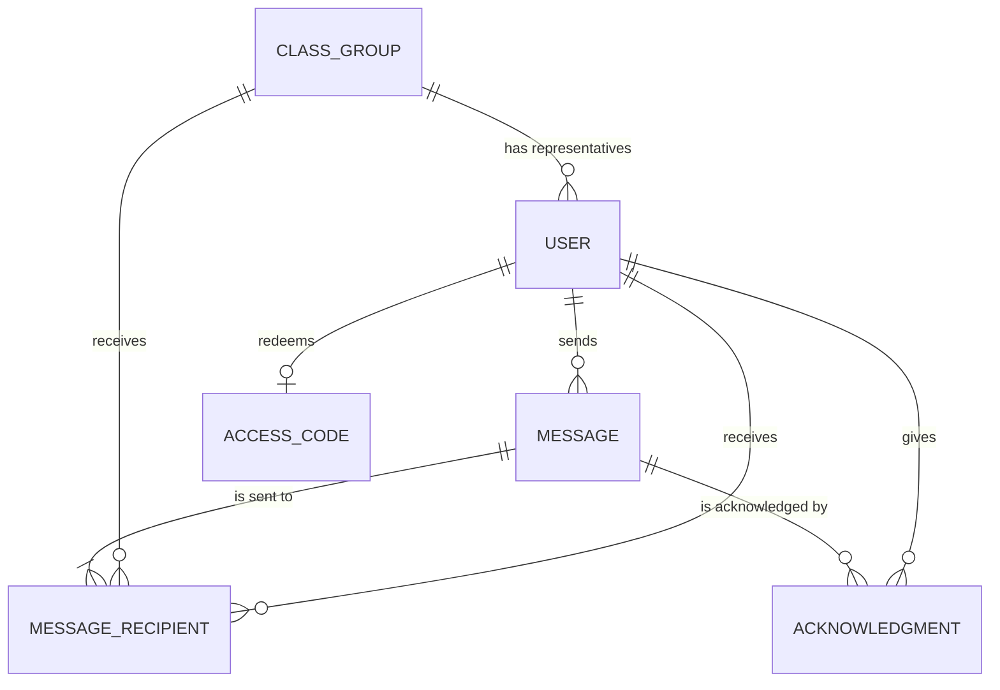

# Data Model

> Status: **Approved** — 2026-10-25.

## Entities

| Entity             | Attributes                                                         | Purpose                                                                                                                                                                                             |
| ------------------ | ------------------------------------------------------------------ | --------------------------------------------------------------------------------------------------------------------------------------------------------------------------------------------------- |
| `User`             | `id`, `telegram_id`, `name`, `role`, `class_group_id`, `is_active` | Authenticated users. `role` is `professor`, `representative` or `vice_representative`. `class_group_id` is set only for representatives. Users are deactivated (`is_active = false`), never deleted |
| `ClassGroup`       | `id`, `name`, `course`                                             | A class group (e.g., ADS, 5th semester)                                                                                                                                                             |
| `AccessCode`       | `id`, `code`, `role`, `class_group_id`, `used_by`, `used_at`       | Single-use code. A filled `used_by` means the code was redeemed                                                                                                                                     |
| `Message`          | `id`, `sender_id`, `text`, `sent_at`                               | Messages sent through the bot. The text is stored once                                                                                                                                              |
| `MessageRecipient` | `id`, `message_id`, `class_group_id`, `user_id`                    | Who a message was sent to: **either** a class group (professor → class groups) **or** a user (representative → professor)                                                                           |
| `Acknowledgment`   | `id`, `message_id`, `user_id`, `acknowledged_at`                   | One row per user who acknowledged a message. Never updated or deleted                                                                                                                               |

## Constraints

- `User.telegram_id` is unique.
- `AccessCode.code` is unique.
- `MessageRecipient`: exactly one of `class_group_id` and `user_id` is filled (`CHECK` constraint).
- `Acknowledgment`: a user can acknowledge a given message only once (unique `message_id` + `user_id`).

## Design notes

- **Single `User` table with `role`** instead of separate tables per user type (role-based access control).
- **`ClassGroup` instead of `Class`:** `class` is a reserved word in Python.
- **`MessageRecipient` link table:** one message can target one or more class groups (many-to-many). It can also target a single professor, so messages in both directions use the same tables.
- **Class group acknowledgment is derived, not stored:** a class group has acknowledged a message when at least one of its representatives has an `Acknowledgment` row for it (BR-06).
- **Soft delete for users:** deleting a user would orphan their `Acknowledgment` rows and destroy the proof they provide (BR-08). A lost account or a new representative is handled by deactivating the old user and issuing a new access code.
- **General notices are not stored:** they are posted in the native Telegram group (BR-09).

## Examples

A professor sends one message to 2 class groups; in one group only the representative acknowledges, in the other both do:

| Table              | Rows created |
| ------------------ | ------------ |
| `Message`          | 1            |
| `MessageRecipient` | 2            |
| `Acknowledgment`   | 3            |

Both class groups count as acknowledged.

A class representative sends one message to a professor, who acknowledges it:

| Table              | Rows created       |
| ------------------ | ------------------ |
| `Message`          | 1                  |
| `MessageRecipient` | 1 (with `user_id`) |
| `Acknowledgment`   | 1                  |

## Entity-relationship diagram

