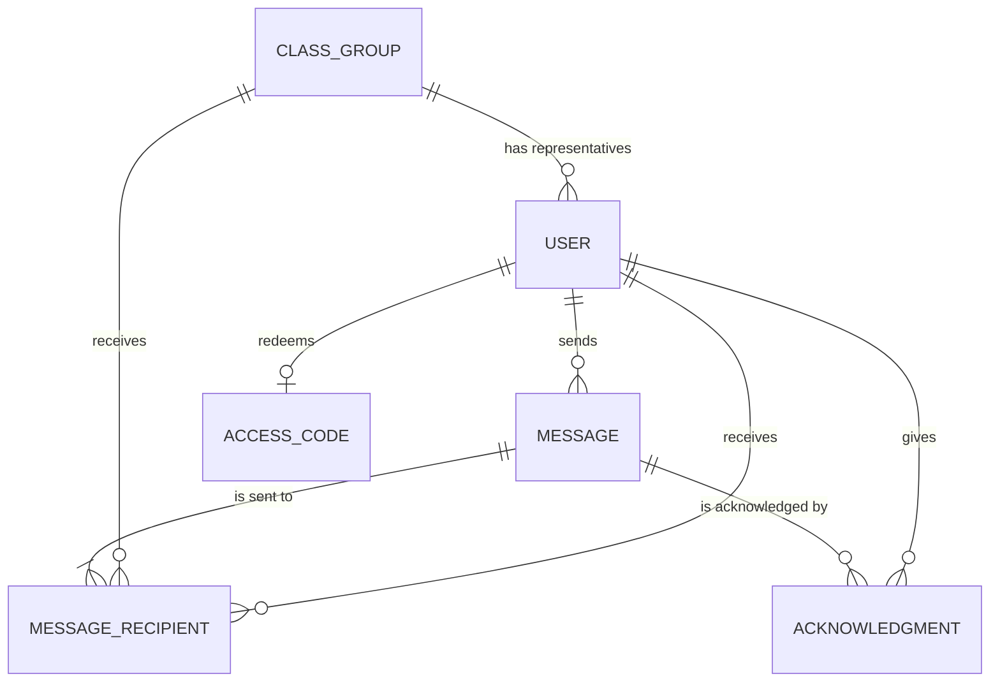

# Data Model

> Status: **Approved** — 2026-10-25. Updated 2026-11-21 with the physical schema decisions (issue #3).

## Entities

| Entity             | Attributes                                                         | Purpose                                                                                                                                                                                             |
| ------------------ | ------------------------------------------------------------------ | --------------------------------------------------------------------------------------------------------------------------------------------------------------------------------------------------- |
| `User`             | `id`, `telegram_id`, `name`, `role`, `class_group_id`, `is_active` | Authenticated users. `role` is `professor`, `representative` or `vice_representative`. `class_group_id` is set only for representatives. Users are deactivated (`is_active = false`), never deleted |
| `ClassGroup`       | `id`, `name`, `course`                                             | A class group (e.g., ADS, 5th semester)                                                                                                                                                             |
| `AccessCode`       | `id`, `code`, `role`, `class_group_id`, `used_by`, `used_at`       | Single-use code. A filled `used_by` means the code was redeemed                                                                                                                                     |
| `Message`          | `id`, `sender_id`, `text`, `sent_at`                               | Messages sent through the bot. The text is stored once                                                                                                                                              |
| `MessageRecipient` | `id`, `message_id`, `class_group_id`, `user_id`                    | Who a message was sent to: **either** a class group (professor → class groups) **or** a user (representative → professor)                                                                           |
| `Acknowledgment`   | `id`, `message_id`, `user_id`, `acknowledged_at`                   | One row per user who acknowledged a message. Never updated or deleted                                                                                                                               |

## Constraints

- `User.telegram_id` is unique among active users, so a deactivated user can return with the same Telegram account and a new access code (BR-10).
- `AccessCode.code` is unique.
- `MessageRecipient`: exactly one of `class_group_id` and `user_id` is filled (`CHECK` constraint).
- `Acknowledgment`: a user can acknowledge a given message only once (unique `message_id` + `user_id`).
- `AccessCode.used_by` is unique: a user redeems at most one code. Unused codes (`used_by` empty) do not conflict with each other.
- `AccessCode`: `used_by` and `used_at` are either both empty (unused code) or both filled (redeemed code) (`CHECK` constraint).
- `MessageRecipient`: a class group or a user appears at most once per message (unique `message_id` + `class_group_id`, unique `message_id` + `user_id`).
- `User.role` and `AccessCode.role` accept only `professor`, `representative` and `vice_representative` (`CHECK` constraint).
- Every column is required (`NOT NULL`) except: `User.class_group_id`, `AccessCode.class_group_id`, `AccessCode.used_by`, `AccessCode.used_at`, `MessageRecipient.class_group_id` and `MessageRecipient.user_id`.
- Foreign keys are enforced on every connection (`PRAGMA foreign_keys = ON`).
- A class group has at most one active user per role (BR-05).
- `User.class_group_id` and `AccessCode.class_group_id` are empty for `professor` and filled for `representative` and `vice_representative` (`CHECK` constraint).
- A redeemed access code cannot be updated or deleted (BR-03, enforced by triggers).
- `Acknowledgment` rows cannot be updated or deleted (BR-08, enforced by triggers).

## Design notes

- **Single `User` table with `role`** instead of separate tables per user type (role-based access control).
- **`ClassGroup` instead of `Class`:** `class` is a reserved word in Python.
- **`MessageRecipient` link table:** one message can target one or more class groups (many-to-many). It can also target a single professor, so messages in both directions use the same tables.
- **Class group acknowledgment is derived, not stored:** a class group has acknowledged a message when at least one of its representatives has an `Acknowledgment` row for it (BR-06).
- **Soft delete for users:** deleting a user would orphan their `Acknowledgment` rows and destroy the proof they provide (BR-08). A lost account or a new representative is handled by deactivating the old user and issuing a new access code.
- **General notices are not stored:** they are posted in the native Telegram group (BR-09).

## Physical schema (SQLite)

| Entity             | Table                |
| ------------------ | -------------------- |
| `User`             | `users`              |
| `ClassGroup`       | `class_groups`       |
| `AccessCode`       | `access_codes`       |
| `Message`          | `messages`           |
| `MessageRecipient` | `message_recipients` |
| `Acknowledgment`   | `acknowledgments`    |

- **Plural, snake_case table names:** a table holds many rows, and `user` is a reserved word in PostgreSQL, the planned future database (ADR-0005). Python classes stay singular (`User`).
- **`STRICT` tables:** SQLite accepts any value in any column by default; `STRICT` rejects values of the wrong type.
- **Booleans as `INTEGER` 0/1:** SQLite has no boolean type. A `CHECK` limits the values. `User.is_active` defaults to 1, so a new user starts active.
- **Timestamps as `TEXT` in ISO 8601, in UTC** (e.g., `2026-11-21T14:30:00+00:00`): SQLite has no date type, ISO 8601 text sorts in chronological order, and UTC avoids time zone ambiguity. All values use the same format with second precision. Times are converted to local time only for display.

## Examples

A professor sends one message to 2 class groups; in one group only the representative acknowledges, in the other both do:

| Table              | Rows created |
| ------------------ | ------------ |
| `Message`          | 1            |
| `MessageRecipient` | 2            |
| `Acknowledgment`   | 3            |

Both class groups count as acknowledged.

A class representative sends one message to a professor, who acknowledges it:

| Table              | Rows created       |
| ------------------ | ------------------ |
| `Message`          | 1                  |
| `MessageRecipient` | 1 (with `user_id`) |
| `Acknowledgment`   | 1                  |

## Entity-relationship diagram

